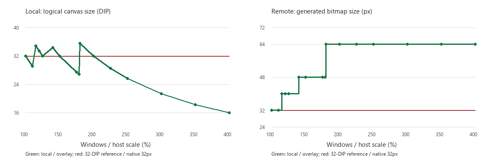
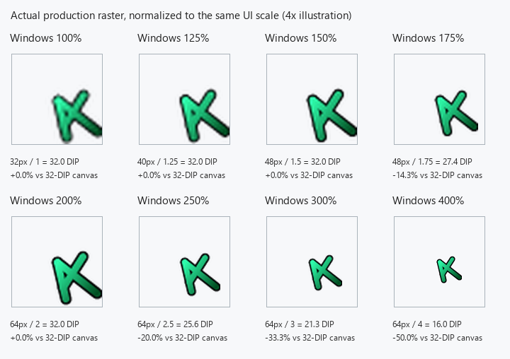

# 키서 크기·배율 상세 점검 — 2026-11-17

## Windows 화살표와 실제 도형 크기 비교

Windows Aero 및 현재 사용자 구성표의 화살표를 독립 로드했다. 동일한32×32px 캔버스에서 알파가0보다 큰 실제 도형 경계상자를 비교한 값이며, 최종 원격 클라이언트 확대는 포함하지 않는다.

|그림|보이는 폭×높이|
|---|---:|
|Windows Aero 화살표|12×18px|
|현재 구성표 화살표|12×18px|
|로컬 키서|18×20px|
|원격용 키서|19×20px|

현재 구성표 화살표 대비 로컬 키서는 폭50%, 높이11.1%, 원격 키서는 폭58.3%, 높이11.1% 크다. 알파128 초과 픽셀은 각각107/156/163개로, 칠해진 면적 지표는45.8%/52.3% 더 크다. 면적과 가로·세로 배율은 다른 지표다.

같은40px 캔버스에서는 현재 화살표17×24px, 로컬 키서22×25px로 폭29.4%, 높이4.2% 차이였다. 따라서 모든 배율을 단일 배수로 설명하지 않는다. 사용한 파일은 Windows `aero_arrow.cur`와 현재 구성표 `arrow_eoa.cur`다.

별도 재현: 생성기 실행 후 `cargo run --manifest-path target/size-audit/Cargo.toml --bin arrow_comparison --offline`. 원시 결과는 `target/size-audit/arrow-comparison.json`이다. 커서 구성표를 바꾸지 않았다.

**판정: 현재 구현은 모든 해상도·배율에서 일정한 크기 경험을 보장하지 못한다.** 일반적인100/125/150/200%의 로컬 일반 커서는32DIP 캔버스에 맞지만, 그 외 배율과 상황별/원격 대체 경로는 기준이 다르다. 검사 중 제품 코드·실행파일·설정·Windows 해상도·배율·키 입력·커서 구성표는 변경하지 않았다.

## 검사 방법과 범위

- 실제 제품의 크기 선택 함수와 GDI+ 그리기 함수를 그대로 추출한 별도 프로그램을 사용했다. 제품의 상태 변수는 일반/눌림 상태의 고정 시험 입력으로 대체했다. 상황별 커서는 제품 모듈을 직접 포함했다. 키보드 훅이나 SetSystemCursor는 호출하지 않고 메모리 DIB에만 그렸다.
- 실제 Windows GDI/GDI+로89개 래스터 생성: 로컬32/40/48/64px의 일반·눌림8개, 원격32px1개, 상황별8종×10크기80개. 생성 이미지마다 투명도·보이는 픽셀·경계상자를 측정했다. 이것은 실제 모니터89개나 원격 기기89대를 시험했다는 뜻이 아니다.
- 배율16개를 실제 제품 함수에 입력했다.6개 해상도(1366×768, FHD, QHD,4K,5K,8K)와 조합한96개 경로 분석에서 해상도 자체는 크기 계산에 들어가지 않음을 확인했다. 이96개는 코드 기반 시나리오이며 디스플레이 모드 전환 실험이 아니다.
- 원격 화면의0.5/0.75/1/1.25/1.5/2배 영상 변환96개는 수학 모델이다. Chrome 원격의 실제 클라이언트 커서 확대 정책은 모사하지 않았다.
- 현재 호스트의 보고값은 1280×1024, DPI 120(배율 125%)이며 모니터1개가 조회됐다. 노트북/안드로이드의 실제 화면 정보는 아니다. 검사 프로그램의 프로세스/스레드는 제품과 같이 Per-Monitor V2로 설정했다.
- 소스3개 SHA-256이 추출 전후 동일하고, 현재 배포본이 마지막 릴리스 빌드와 일치함을 확인했다. 제품은 실행 중인 상태로 두었다.

## 1. 로컬 배율은 구간별 반올림과200% 상한이 있다

32DIP 캔버스를 일정하게 유지하려면 물리 픽셀은 `32 × Windows 배율`이어야 한다. 현재는115%에서40px,140%에서48px,180% 이상에서64px로 갑자기 바뀐다. 아래 숫자는 생성 이미지 캔버스이며 실제 색칠된 도형 크기와 다르다.

| Windows 배율 | 로컬 생성 캔버스(px) | 배율로 나눈 크기(DIP) | 32DIP 대비 | 원격 native / overlay 캔버스(px) |
|---|---:|---:|---:|---:|
| 100% | 32 | 32.00 | +0.0% | 32 / 32 |
| 125% | 40 | 32.00 | +0.0% | 32 / 40 |
| 150% | 48 | 32.00 | +0.0% | 32 / 48 |
| 175% | 48 | 27.43 | -14.3% | 32 / 48 |
| 200% | 64 | 32.00 | +0.0% | 32 / 64 |
| 225% | 64 | 28.44 | -11.1% | 32 / 64 |
| 250% | 64 | 25.60 | -20.0% | 32 / 64 |
| 300% | 64 | 21.33 | -33.3% | 32 / 64 |
| 350% | 64 | 18.29 | -42.9% | 32 / 64 |
| 400% | 64 | 16.00 | -50.0% | 32 / 64 |

175→180%에서는 Windows 배율이 약2.9% 변하지만 생성 캔버스는48→64px로33.3% 뛴다. 반대로300%에서는32DIP 기준보다33.3%,400%에서는50% 작아진다. 따라서 중간·고배율에서 너무 크거나 작아질 위험이 있다.

아래는 실제 생성 그림을 같은 UI 배율 기준으로 환산한4배 확대 설명 그림이다. 회색 상자는32DIP 기준이며 실제 원격 화면 캡처가 아니다. 이 그림은 생성 단계의 차이를 보여주며 OS나 클라이언트가 추가로 확대·축소한 최종 화면까지 검증하지 않는다.

## 2. 일반 커서와 상황별 커서의 크기 기준이 다르다

일반 로컬 커서는 위 구간별 배율을 사용한다. 입력/크기 조절/밝은 키서는 `GetSystemMetrics(SM_CXCURSOR).max(32)`를 사용한다. 검사 프로세스에서 이 값은32였고, 현재 호스트125%의 일반 커서는40px로 생성된다. 즉40px 일반 그림에서32px 상황별 그림으로 바뀔 수 있다.

실제 그림의 비투명 경계상자로 비교하면125% 일반 키서는22×25px, 동일 계열의 밝은 키서32px 그림은18×19px였다. 단, 이 수치는 설치 전 생성 이미지 측정이며 Windows가 커서 등록 후 적용하는 변환까지 직접 측정한 값은 아니다.

Microsoft는 Per-Monitor DPI-aware 스레드에서 GetSystemMetrics 대신 DPI 대응 API 사용을 안내한다. 실제 GetSystemMetricsForDpi 검사에서도125%에32,150%에48,250%에64 등 구간별 값이 나와 **API만 교체하는 것으로 정확한32DIP 일관성을 보장할 수는 없다.** 동일한 키서 크기가 목표라면 일반/상황별 그림에 같은 논리 크기 공식을 적용해야 한다.

## 3. 원격32px 고정은 시스템 커서 경로에만 해당한다

원격의 OS 커서 비트맵과 상황별 OS 커서는32px다. Windows 커서가 보이지 않아 켜지는 화면 오버레이는32/40/48/64px로 호스트 배율을 따른다. 따라서125%에서1.25배,150%에서1.5배,200% 이상에서2배의 생성 캔버스 차이가 생긴다. 두 경로의 최종 클라이언트 표시 크기는 별도 전송/확대 정책을 거치므로 이 차이가 그대로 보인다고 단정할 수는 없지만, 같은 크기로 만든 상태는 아니다.

화면 오버레이는 화면 영상과 함께 확대·축소되며, 네이티브 커서는 Chrome 원격이 별도 그림·DPI 정보로 전달한다. 클라이언트 앱은 각 경로를 다르게 처리할 수 있다. 키서에는 현재 접속 노트북·안드로이드의 viewport/줌/DPI를 직접 수신해 정규화하는 코드가 없다.

영상에 포함된64px 오버레이는 영상 배율50%이면32px,200%이면128px가 되는 식이다. 이것은 변환 예시이며 실제 Chrome 원격 설정에 대한 측정값이 아니다. Android/노트북의 같은 크기·화질·모션 경험은 양쪽 클라이언트를 직접 검증하지 않고 확정할 수 없다.

## 4. 클릭 모션과 실제 색칠된 영역

평소 캔버스32px는 도형32px를 뜻하지 않는다. 실제 일반 그림은 로컬32px에서18×20px, 원격32px에서19×20px였다. 키를 누를 때 코드가 도형 좌표를0.7배로 줄이되 선 굵기는 유지하므로 보이는 외곽 크기가 정확히70%가 되지는 않는다. 이 변화는 클릭 피드백이며 해상도에 따른 크기 변화와 별개다.

## 권장 수정 기준 — 이번 점검에서는 미적용

1. 기준은 사용자가 익숙한100%의32px 캔버스, 즉32DIP로 잡고 이를 전체적으로 더 키우지 않는다. 125%에서는40px,175%에서는56px,250%에서는80px 등 정확한 배율로 모든 로컬 역할을 직접 렌더링한다. 고배율 상한을 임의64px로 고정하지 않는다.
2. 로컬 동작이 괜찮다는 기존 요청을 지켜, 로컬 정책 변경은 자동으로 배포하지 않는다. 이 검사에서는 문제만 확인했다.
3. 원격에서는 OS 커서와 화면 오버레이에 서로 다른 배율을 적용하지 않도록 하나의 크기 정책부터 만든다. 다만 OS 커서와 영상 경로가 클라이언트에서 어떻게 확대되는지 확인하지 않고 무조건 같은 물리 픽셀을 적용해도 해결된다고 말할 수는 없다. 임의로 호스트 DPI를 곱해 키우는 방식은 재사용하지 않는다.
4. 회귀 기준은 캔버스·그림 경계·핫스폿·선 굵기·일반/상황별 전환·클릭 모션을 함께 측정하는 것으로 정한다. 단순히 HCURSOR 생성 성공만으로 크기 경험을 통과 처리하지 않는다.
5. 같은 UI 상대 크기(DIP)는 목표로 삼을 수 있지만, 어떤 화면에서도 같은 물리적 mm를 보장하려면 화면의 실제 PPI와 사용자 배율 보정이 필요하다. 해상도만으로는 화면의 실제 크기를 알 수 없다. 원격 줌까지 고정하지 않고 모든 기기에서 같은 최종 크기를 보장하는 것은 현재 구조로는 불가능하다.

## 근거와 파일

- 제품 소스: `src/ui/win_gdi.rs`의 get_indicator_dpi_scale / update_indicator_layered_image / draw_cursor_artwork, `src/cursor_scheme.rs`의 cache_artwork / set_custom, `src/cursor_scheme/context.rs`.
- 원시 결과: `target/size-audit/native-results.json`, 소스 지문 `source-inputs.json`, 배율표 `scale-matrix.csv`,96개 해상도 시나리오 `resolution-scale-scenarios.csv`.
- 재현: `python scratch/generate_size_audit.py`, `cargo run --manifest-path target/size-audit/Cargo.toml --offline`, `python scratch/analyze_size_audit.py`.
- [Microsoft DPI 안내](https://learn.microsoft.com/en-us/windows/win32/hidpi/high-dpi-desktop-application-development-on-windows)
- [GetSystemMetrics 제한](https://learn.microsoft.com/en-us/windows/win32/api/winuser/nf-winuser-getsystemmetrics)
- [GetSystemMetricsForDpi](https://learn.microsoft.com/en-us/windows/win32/api/winuser/nf-winuser-getsystemmetricsfordpi)
- [Chrome 원격 커서/화면 프로토콜](https://chromium.googlesource.com/chromium/src/+/refs/heads/main/remoting/proto/control.proto)
